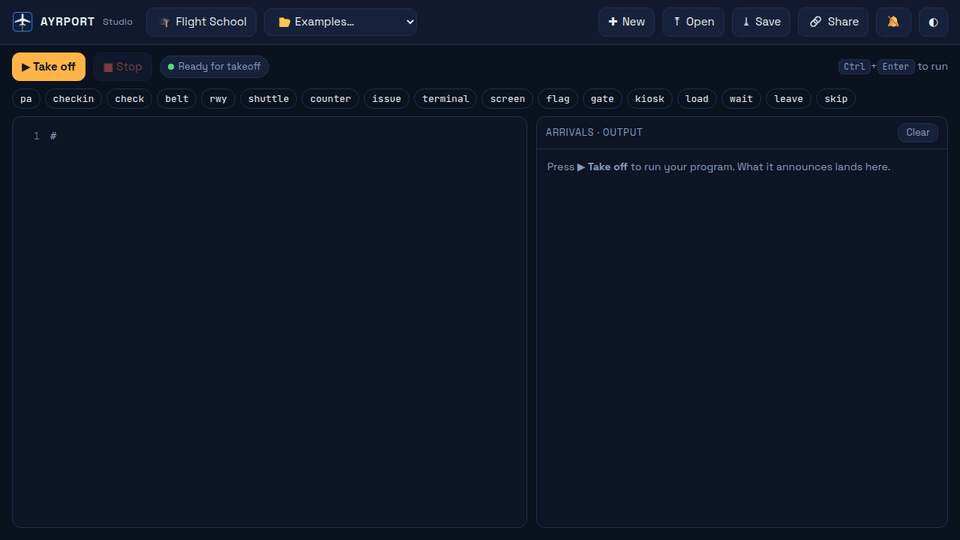
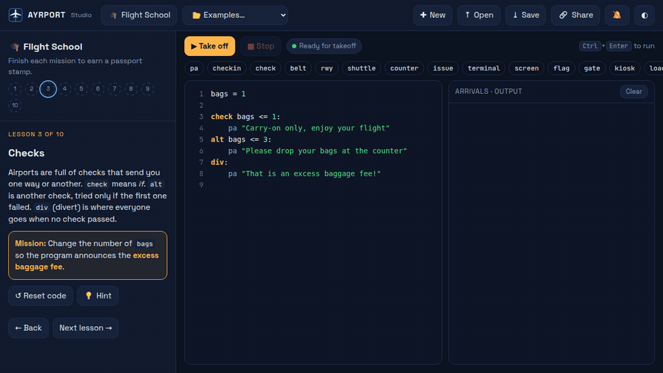
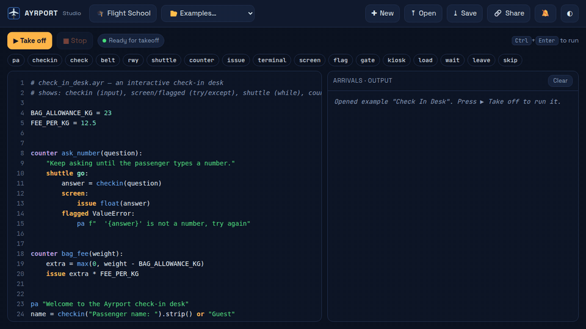
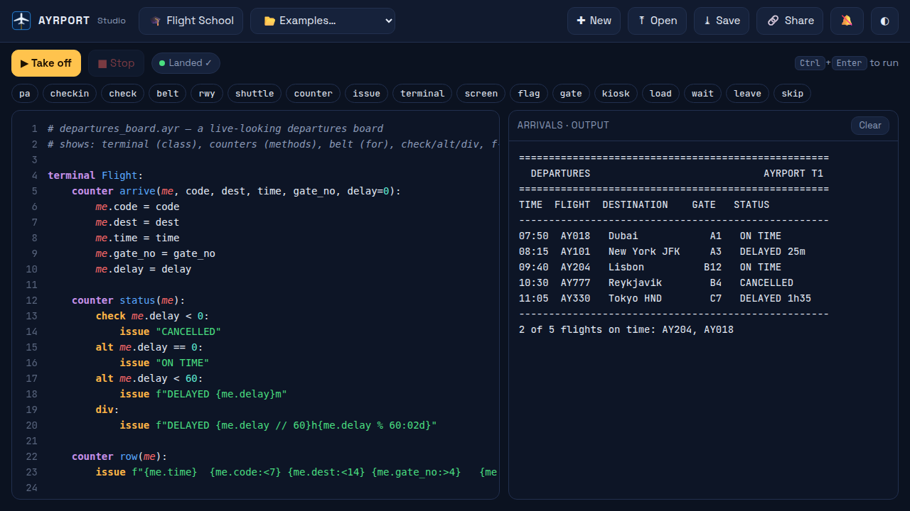
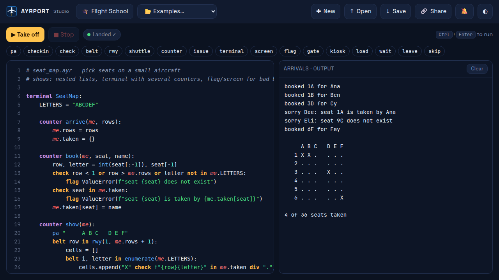
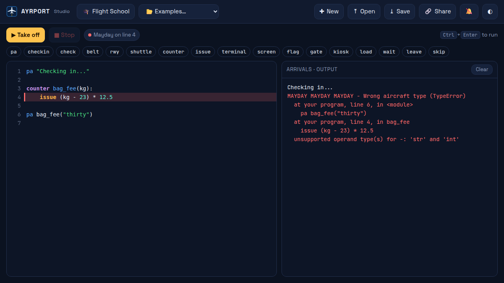
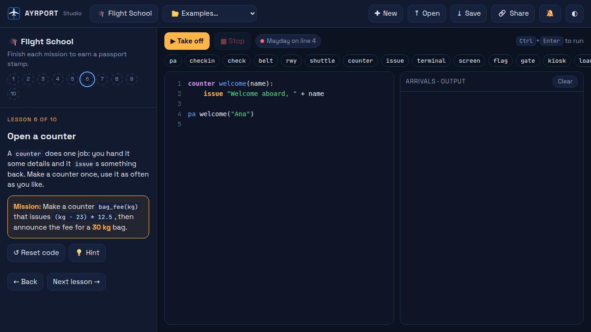
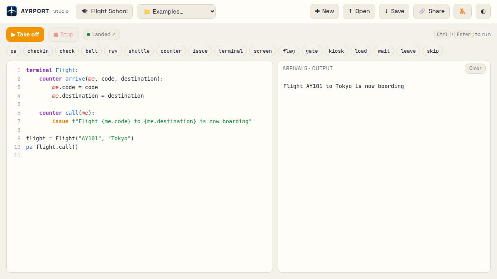
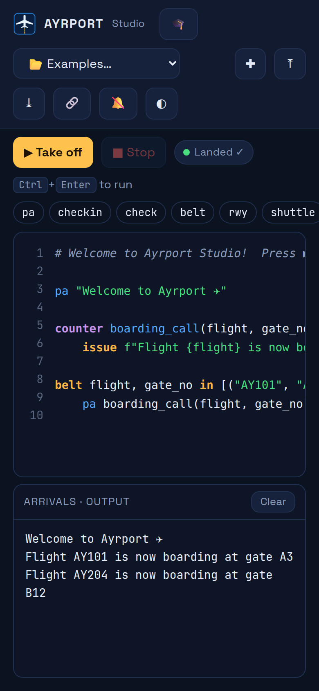

<p align="center">
  
</p>

<h1 align="center">Ayrport</h1>

<p align="center"><b>A programming language spoken in airport and flight terms.</b><br>
Short words, Python power. Runs anywhere Python runs.</p>

<p align="center">
  <a href="https://github.com/megazron/ayrport/actions/workflows/ci.yml"></a>
  
  
</p>

<p align="center">
  <a href="https://megazron.github.io/ayrport/"></a>
</p>

```ayr
terminal Flight:
    counter arrive(me, code, seats):
        me.code = code
        me.seats = seats

    counter status(me, delay):
        check delay == 0:
            issue "ON TIME"
        alt delay < 30:
            issue "DELAYED"
        div:
            issue "CANCELLED"

flight = Flight("AY101", 180)
belt d in [0, 12, 95]:
    pa flight.code, flight.status(d)
```

```
AY101 ON TIME
AY101 DELAYED
AY101 CANCELLED
```

## Try it now — nothing to install

**[▶ Open Ayrport Studio](https://megazron.github.io/ayrport/)** in any browser.
Write code, press **Take off**, and watch the result land. Python runs right
inside the page, so there is nothing to download.

### Flight School

Ten short missions teach the language one word at a time. Finish a mission to
earn a passport stamp.

<p align="center"></p>

### Programs that talk back

`checkin` asks a question and waits for the answer, right in the output panel.

<p align="center"></p>

### More of the Studio

| | |
|---|---|
|  |  |
| A departures board, from the **Examples** menu | Booking seats on a seat map |
|  |  |
| Mistakes get a plain-words **MAYDAY** and a red line | Every lesson has a story, a mission and a hint |
|  |  |
| Light theme | Works on phones too |

## Install

```bash
pip install git+https://github.com/megazron/ayrport
```

This gives you the `ayr` command and the `ayrport` Python package.

## Run

```bash
ayr flight.ayr            # run a file
ayr                       # open the tower (interactive prompt)
ayr build flight.ayr      # show the Python it compiles to (-o out.py to save)
ayr check *.ayr           # check files for errors without running them
ayr words                 # list every Ayrport word
```

`python -m ayrport ...` works the same way.

## The words

Every keyword is an airport thing that **behaves like** the code it stands for.

**Counters and terminals**

| Ayrport    | Python     | Why                                                         |
|------------|------------|-------------------------------------------------------------|
| `counter`  | `def`      | you hand your details to a counter and it does one job      |
| `issue`    | `return`   | the counter issues something back to you                    |
| `kiosk`    | `lambda`   | a self-service counter: tiny and nameless                   |
| `drop`     | `yield`    | bag drop: hand one over, come back for the next             |
| `terminal` | `class`    | a terminal groups its own counters and data                 |
| `arrive`   | `__init__` | runs when a new one arrives                                 |
| `me`       | `self`     | the object itself (just a convention)                       |

**Checks and loops**

| Ayrport    | Python     | Why                                                         |
|------------|------------|-------------------------------------------------------------|
| `check`    | `if`       | go this way only if the check passes                        |
| `alt`      | `elif`     | an alternative check, tried when the ones above failed      |
| `div`      | `else`     | divert: where everyone goes when no check passed            |
| `belt`     | `for`      | every bag on the baggage belt passes once                   |
| `shuttle`  | `while`    | the shuttle keeps looping round while it is needed          |
| `leave`    | `break`    | leave the loop now                                          |
| `skip`     | `continue` | skip to the next one                                        |
| `standby`  | `pass`     | on standby: nothing happens                                 |

**Security**

| Ayrport    | Python     | Why                                                         |
|------------|------------|-------------------------------------------------------------|
| `screen`   | `try`      | everything inside goes through screening                    |
| `flagged`  | `except`   | what to do when screening flags a problem                   |
| `customs`  | `finally`  | everyone passes customs, flagged or not                     |
| `flag`     | `raise`    | flag a problem for security to handle                       |
| `xray`     | `assert`   | x-ray check: must be fine or you stop here                  |

**Gates, cargo and the PA**

| Ayrport    | Python       | Why                                                       |
|------------|--------------|-----------------------------------------------------------|
| `gate`     | `with`       | a gate opens for you and closes behind you                |
| `load`     | `import`     | load cargo on board                                       |
| `pa`       | `print(...)` | the public announcement system                            |
| `checkin`  | `input`      | check-in asks the passenger for their details             |
| `rwy`      | `range`      | a runway of numbers                                       |
| `wait`     | `time.sleep` | wait at the gate                                          |
| `go` / `nogo` / `nil` | `True` / `False` / `None` |                                |

`load sqrt, pi from math` is `from math import sqrt, pi`.
A one-line choice reads `"on time" check delay == 0 div "late"`.

Full guide: **[docs/language.md](docs/language.md)**.

## Use Ayrport from Python

Ayrport is also a Python library. Importing it lets Python `import` any `.ayr`
file like a normal module:

```python
import ayrport
import flightdeck                    # loads flightdeck.ayr

print(flightdeck.eta(5600))

ns = ayrport.run('counter hi(x):\n    issue f"hi {x}"\n')   # run a snippet
print(ns["hi"]("there"))

print(ayrport.transpile('check fuel < 10: pa "low fuel"'))
# if fuel < 10: print("low fuel")
```

| Function | What it does |
|---|---|
| `ayrport.run(source)` | run Ayrport code, return its variables |
| `ayrport.run_file(path)` | run an `.ayr` file |
| `ayrport.transpile(source)` | Ayrport source → Python source |
| `ayrport.compile_ayr(source)` | Ayrport source → Python code object |
| `ayrport.install()` / `uninstall()` | turn the `.ayr` import hook on/off (on by default) |

And it works the other way too: `load numpy as np` inside Ayrport loads any
Python library.

## VS Code extension

The [`vscode-extension`](vscode-extension) folder holds the Ayrport extension:
syntax highlighting, hover cards that explain every word, completions,
snippets, auto-indent, red underlines on errors, and a ▶ **Run** button (F5). Ayrport is bundled inside it, so it only needs Python.

**Install:** download `ayrport-1.3.0.vsix` from the
[latest release](https://github.com/megazron/ayrport/releases/latest), then

```bash
code --install-extension ayrport-1.3.0.vsix
```

or in VS Code: *Extensions → ⋯ → Install from VSIX…*

Build it yourself with `cd vscode-extension && npx @vscode/vsce package`.

## Crashes, in airport terms

```
MAYDAY MAYDAY MAYDAY - Runway length zero (ZeroDivisionError)
  at crash.ayr, line 4, in boom
    issue 1 / 0
  division by zero
```

Error lines always point at your `.ayr` file: Ayrport keeps line N of your code
as line N of the Python it runs.

## How it works

```
flight.ayr ──► lexer ──► token rewrite ──► Python source ──► CPython
                 │            │
     strings and comments     check→if, counter→def, pa x→print(x),
     are never touched        load a from m→from m import a
```

- `src/ayrport/words.py`, the whole vocabulary in one table
- `src/ayrport/lexer.py`, splits code from strings and comments
- `src/ayrport/transpiler.py`, the token rewriter
- `src/ayrport/importer.py`, the `.ayr` import hook
- `src/ayrport/cli.py`, the `ayr` command and the tower REPL

## Examples

[`examples/`](examples) has 18 programs, from `hello.ayr` to a departures
board, a security line with custom errors, a baggage carousel built on
generators, a seat map, a shortest-route planner, and an Ayrport package that
plain Python imports. See [`examples/README.md`](examples/README.md) for the
full list.

```bash
cd examples
ayr departures_board.ayr
```

## Develop

```bash
git clone https://github.com/megazron/ayrport && cd ayrport
pip install -e ".[test]"
pytest
```

## License

MIT © Gaus Mohiuddin Sayyad
